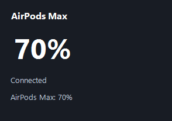
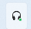

# AirPods Battery Tray for Windows

Check your AirPods battery from the Windows notification area. Click the headphone icon to open a compact panel with the battery percentage and connection status.



*Click to view battery details.*



*The notification-area icon.*

## Install

1. Download **AirPodsBatteryTray.msi** from the [latest release](https://github.com/ckenst/windows-airpod-battery/releases/latest). Expand **Assets** if necessary.
2. If you already have the app running, right-click its tray icon and select **Exit**.
3. Run the MSI and follow the installation prompts.
4. Open **AirPods Battery Tray** from the Start menu.

The release installer is built for **64-bit Windows** and includes the .NET runtime—you don't need to install .NET separately.

The app starts with Windows by default. You can change this through its right-click menu. If you don't see the headphone icon, check the notification area's hidden-icons menu.

## Windows security warning

The current installer is **unsigned**, so Windows may display **“Windows protected your PC”** or identify the publisher as **Unknown publisher**.

If you downloaded the installer directly from this repository's GitHub Releases page and trust it, select **More info → Run anyway**, if Windows offers that option.

A work-managed computer may prevent installation. In that case, contact your IT administrator. You don't need to disable Microsoft Defender or SmartScreen.

## Use

- **Left-click** the headphone icon to open the battery panel.
- **Click again, click elsewhere, or press Escape** to dismiss it.
- **Right-click** for refresh, low-battery notification settings, startup settings, and exit.

When the headphones connect, the panel may show **“Checking battery…”** until a battery broadcast arrives. If a previous reading exists, it shows **“Last reported”** while checking for an update. When disconnected, it shows the connection status and the last reported percentage, if available.

The app reads Bluetooth battery broadcasts, so readings may not update immediately. Keep Bluetooth enabled and your AirPods paired. Battery details appear in the click panel instead of a hover tooltip.

## Device support

Developed and tested with **AirPods Max**. The parser also recognizes several AirPods and AirPods Pro models, but those models have not been verified to the same extent.

## Project structure

- `src/AirPodsBattery.Core` — shared AirPods advertisement parsing
- `src/AirPodsBattery.Discovery` — Bluetooth and advertisement diagnostic tool
- `src/AirPodsBattery.Tray` — tray application
- `installer` — WiX MSI and portable PowerShell installer scripts

## Build the tray app

Install a current .NET 10 SDK before building. Self-contained publishes use the latest runtime patch supplied by that SDK.

```powershell
dotnet build .\src\AirPodsBattery.Tray\AirPodsBattery.Tray.csproj
dotnet run --project .\src\AirPodsBattery.Tray\AirPodsBattery.Tray.csproj
```

Run the panel-state tests:

```powershell
dotnet run --project .\tests\AirPodsBattery.Tray.Tests\AirPodsBattery.Tray.Tests.csproj
```

## Build a distributable MSI

Install WiX Toolset if it isn't already available:

```powershell
dotnet tool install --global wix --version 7.0.1
```

Publish the self-contained app, then build the WiX package. Run these commands from the repository root, stopping if either fails:

```powershell
dotnet publish .\src\AirPodsBattery.Tray\AirPodsBattery.Tray.csproj -c Release -r win-x64 --self-contained true -p:PublishSingleFile=true -p:IncludeNativeLibrariesForSelfExtract=true -o .\dist\AirPodsBatteryTray
wix build .\installer\Product.wxs -d SourceDir="$PWD\dist\AirPodsBatteryTray" -o .\dist\AirPodsBatteryTray.msi
```

The project copies the icon assets into the publish output automatically. The generated MSI belongs in a GitHub Release, not in the source repository; `dist` is ignored by Git.

## Publish a release

Before building a new release, update the app versions in `Directory.Build.props` and the MSI version in `installer/Product.wxs` to match. Increase one of the first three version components so Windows recognizes it as an upgrade.

Run the tests and rebuild the MSI from the release source. Commit and push the source changes, then create and push the corresponding version tag. On GitHub, create a release using that tag and attach `dist/AirPodsBatteryTray.msi` under **Assets**. Pushing source changes alone does not rebuild or publish the installer.
